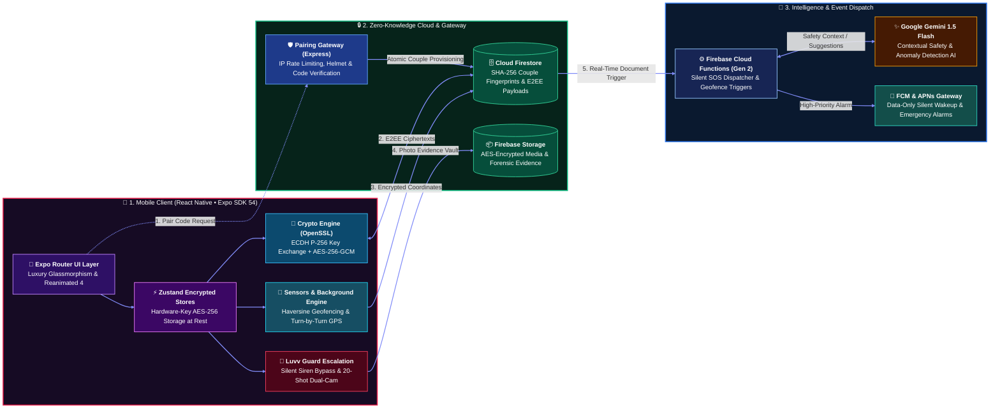

# ❤️ LUVV — Private Couple & Relationship Protection Platform

<p align="center">
  
  
  
  
  
  
</p>

---

## 📌 Executive Summary

**LUVV** is a private, real-time couple application and personal safety ecosystem built with a **Zero-Knowledge Architecture**. Designed for couples who value privacy, safety, and deep emotional connection, LUVV bridges physical distance through live location intelligence, physiological haptic feedback, end-to-end encrypted messaging, and AI-driven contextual protection.

Unlike conventional tracking or social apps that harvest and monetize intimate relationship data, LUVV enforces **military-grade client-side encryption (NIST P-256 ECDH + AES-256-GCM)** where sensitive information—such as messages, coordinates, destination names, emergency contacts, and personal dates—is cryptographically shielded before leaving the device. Even the cloud backend and database operate in a zero-knowledge posture.

---

## 💎 Engineering Highlights & Key Innovations

### 1. 🛡️ Military-Grade End-to-End Encryption (E2EE)
* **ECDH Key Agreement (NIST P-256)**: Mutual public key exchange generated via WebCrypto SubtleCrypto / native OpenSSL (`react-native-quick-crypto`).
* **Authenticated AES-256-GCM Encryption**: PBKDF2 key derivation using 100,000 iterations of SHA-256, cryptographically random 16-byte salt, 12-byte IV, and 16-byte authentication tags. Fresh salts and IVs per operation prevent replay attacks and pattern recognition.
* **Hardware-Backed Keychain**: Private keys reside exclusively in `expo-secure-store` protected with `AFTER_FIRST_UNLOCK_THIS_DEVICE_ONLY` access control and automatic lock-retry handling.
* **Encrypted Client Persistence**: Local Zustand stores (messages, offline cache) are encrypted at rest with hardware device keys via a custom `encryptedStorage` engine.
* **Encrypted Backup System (`.luvvbackup`)**: Full zero-knowledge data export/import protected with PBKDF2-SHA256 stretching.

### 2. 🚨 Next-Gen Emergency & Safety Engine ("Luvv Guard")
* **Dual-Mode SOS System**:
  * **Audible Critical SOS**: Loops an oscillating high-decibel alarm bypassing iOS Silent Mode via `Audio.setAudioModeAsync`, paired with high-frequency panic haptic pulses.
  * **Stealth / Silent SOS (Victim Silence Mode)**: Activates an immediate software brake suppressing all screen flashes, vibration, and speaker audio on the victim's device while silently broadcasting live GPS coordinates and alerting the partner.
* **Automated Dual-Camera Evidence Capture**: Discreetly fires sequential bursts of 10 high-resolution photos from the rear camera and 10 from the front camera, immediately encrypting and uploading evidence to Firebase Storage, posting to the couple's chat, and dispatching via WhatsApp.
* **Biometric Disarm Barrier**: Deactivating an active SOS emergency requires FaceID / Fingerprint biometric authentication, preventing an assailant from silencing the alarm.
* **Prioritized Guardian Queue**: Drag-and-drop reorderable emergency contact list (`react-native-draggable-flatlist`) with native phone contacts integration (`expo-contacts`) and automated SMS Google Maps routing.

### 3. 🚶 Smart Geofencing & "WalkSafe" Mode
* **Geofenced Trip Tracking**: Real-time path tracing (`pathEnc`) with sub-5-meter distance resolution and dynamic arrival detection.
* **Overdue Safety Escalation**: Automatic 2-minute safety grace period when a trip is overdue. If the user fails to confirm their safety or extend the timer, the system automatically triggers a critical SOS alert to the partner.
* **Zero-Knowledge Geofence Pushes**: Cloud Functions issue data-only APNs/FCM push notifications containing encrypted place names (`placeNameEnc`). The recipient device wakes up in the background and decrypts the place name locally—ensuring push notification relays never learn user locations.
* **Background Battery & State Monitoring**: Native foreground service tracking battery depletion (15% warning, 5% critical broadcast) and charging status.

### 4. 🧠 Contextual AI Safety Intelligence (Google Gemini 1.5 Flash)
* **Cloud-Native AI Analysis**: Firebase Cloud Functions Gen 2 leveraging Google Gemini 1.5 Flash to evaluate real-time multi-variable contextual data:
  * Battery levels and charging velocity
  * Time of day and late-night movement patterns
  * Real-time transit velocity and route deviation
* **Proactive Protection**: Non-alarmist, actionable safety insights (e.g. suggesting WalkSafe mode during late night hours or warning before a partner's phone dies).
* **Deterministic Edge Fallback**: Automatic failover to local rule-based safety insights during network disruption or latency spikes.

### 5. 🫀 Intimate Relationship Connectivity
* **Heartbeat Ping & Physiological Haptics**: Sends a real-time digital touch producing a ~67 BPM physiological "lub-dub" double-pulse haptic vibration on the partner's device with a full-screen pulsing heart animation.
* **Relationship Pulse Live Ticker**: A down-to-the-second live ticker (Days, Hours, Minutes, Seconds) celebrating time spent together since the anniversary.
* **Real-Time Physical Proximity**: High-precision Haversine distance calculations rendered live between partners.
* **Remote Ringing**: Acoustic find-my-phone feature triggering a 28-second Tingg-Tingg chime on the partner's device on demand, even from silent mode.
* **Daily Connection Streaks**: Atomic Firestore transactions recording mutual interactions (messages, pings, photos, memories).
* **Private E2EE Chat**: Media sharing with progress indicators, background caching via `expo-file-system`, delivery receipts (`isDelivered`), and read receipts (`isRead`).

---

## 🏛️ System Architecture



> **Architecture Highlights & Security Boundaries:**
> * 🟣 **Stage 1 (Client Hardware Tier):** End-to-end encryption keys and decrypted plaintexts exist strictly within local hardware memory. State persistence is encrypted at rest using AES-256 backed by on-device entropy.
> * 🟢 **Stage 2 (Zero-Knowledge Cloud Tier):** Cloud Firestore and Firebase Storage only ingest pre-encrypted ciphertexts and SHA-256 couple fingerprints. Firebase servers have zero mathematical capability to decrypt location traces, chat histories, or emergency photos.
> * 🔵 **Stage 3 (Intelligence & Push Tier):** Firebase Cloud Functions process trigger events and collaborate with Google Gemini 1.5 Flash for proactive contextual safety assessments, dispatching zero-knowledge data-only silent wakeup notifications via APNs/FCM.


---

## 🔐 Cryptographic Specification & Security Architecture

| Component | Standard / Algorithm | Implementation Detail |
| :--- | :--- | :--- |
| **Key Exchange** | NIST P-256 ECDH | Client-side keypair generation via `react-native-quick-crypto` and `crypto.subtle`. Public keys shared via QR/invite; private keys never leave local hardware. |
| **Symmetric Encryption** | AES-256-GCM | Authenticated cipher with 128-bit authentication tag, 96-bit cryptographically secure random IV, and 128-bit random salt per payload. |
| **Key Derivation** | PBKDF2-HMAC-SHA256 | 100,000 iterations to stretch derived shared secrets into 256-bit AES cipher keys. |
| **Key Storage** | Hardware Keychain / Keystore | Stored in `expo-secure-store` with `AFTER_FIRST_UNLOCK_THIS_DEVICE_ONLY`. |
| **Couple Fingerprint** | SHA-256 Hash | Couple identifiers are deterministic hashes of sorted user IDs: `SHA-256(min(A,B) + '_' + max(A,B))`, preventing user association leakage. |
| **Storage at Rest** | AES-256 Device-Key | Client-side state persistence wrapped in `encryptedStorage` backed by on-device hardware entropy. |
| **Push Notification Privacy** | Zero-Knowledge APNs / FCM | Location names are never sent in push notification payloads. Data-only pushes wake up device for local decryption. |
| **Database Access Control** | Firestore Security Rules | Strict Role-Based Access Control (RBAC) ensuring users can only read/write their own records or their verified partner's paired documents. |

---

## 🛠️ Technology Stack

### Mobile Client (`apps/mobile`)
* **Core Framework**: React Native `0.81.5` / React `19.1.0`
* **Runtime & Tooling**: Expo SDK `54.0.0` with custom native config plugins (`withPodfileFix.js`, `withNoPushEntitlement.js`)
* **Routing**: Expo Router `v6` (typed, file-based routing architecture)
* **Animation & UI**: React Native Reanimated `4.1`, Gesture Handler `2.28`, Expo Blur (glassmorphism), Linear Gradient
* **Typography & Design**: Playfair Display (editorial serif) & DM Sans (modern sans), curated romantic dark-mode palette
* **Mapping & Navigation**: Google Maps SDK / React Native Maps (`1.27`), Google Places Autocomplete, Expo Speech (turn-by-turn voice guidance)
* **Native Sensors & Hardware**: Expo Camera `17.0` (dual-camera burst capture), Expo Battery `10.0`, Expo Haptics `15.0`, Expo Location `19.0`, Expo Task Manager `14.0`, Expo Local Authentication `17.0` (FaceID/Biometrics)
* **State Management**: Zustand `5.0` with custom encrypted persistence middleware

### Backend & Cloud Services (`apps/server` & `functions`)
* **Cloud Functions**: Firebase Functions Gen 2 (Node.js 20, TypeScript)
* **AI Intelligence**: `@google/generative-ai` (Gemini 1.5 Flash)
* **Server Framework**: Node.js + Express, Helmet, CORS, Crypto
* **Database & Auth**: Firebase Auth, Cloud Firestore (atomic transactions, subcollections), Firebase Cloud Storage
* **Messaging**: Firebase Cloud Messaging (FCM) & Apple Push Notification Service (APNs)

### Cryptography & Utilities
* `react-native-quick-crypto` (native OpenSSL C++ bindings for fast cryptographic operations)
* `expo-crypto` & `expo-secure-store`
* `date-fns` & `sharp`

---

## 📂 Monorepo Structure

```text
ProjectLuvv/
├── apps/
│   ├── mobile/                           # React Native / Expo Client Application
│   │   ├── app/                          # Expo Router routes
│   │   │   ├── (auth)/                   # Authentication & secure pairing screens
│   │   │   │   ├── pairing.tsx           # 6-digit ECDH key exchange & pairing UI
│   │   │   │   └── setup-profile.tsx     # Encrypted profile initialization
│   │   │   ├── (app)/                    # Authenticated couple experience
│   │   │   │   ├── (tabs)/               # Bottom tab navigation (Home, Location, Safety, Timeline)
│   │   │   │   ├── chat/                 # Real-time E2EE messaging screen
│   │   │   │   └── partner-profile.tsx   # Relationship pulse, live distance & intimacy screen
│   │   │   └── _layout.tsx               # Root layout & authentication state router
│   │   ├── hooks/                        # Native build hooks & config plugins (withPodfileFix.js)
│   │   ├── src/
│   │   │   ├── components/               # Modular UI components (Map, Radar, SOS, Cards)
│   │   │   │   ├── Location/             # Navigation overlays, geofence modals, custom markers
│   │   │   │   ├── Safety/               # EmergencyCapture (dual-camera), contact modals
│   │   │   │   └── ui/                   # Design system tokens (Avatars, Badges, PingButtons)
│   │   │   ├── services/                 # Core business & platform services
│   │   │   │   ├── encryption/           # AES-256-GCM, ECDH key derivation, base64 encoding
│   │   │   │   ├── location/             # Tracking, WalkSafe monitor, SOS service, pings
│   │   │   │   ├── aiService.ts          # Gemini safety context integration
│   │   │   │   ├── alertService.ts       # Audio session override & multi-tier haptics
│   │   │   │   ├── backupService.ts      # Zero-knowledge .luvvbackup export/import
│   │   │   │   ├── biometricService.ts   # FaceID / Fingerprint security gate
│   │   │   │   └── pairingService.ts     # Atomic Firestore pairing & ECDH exchange
│   │   │   ├── store/                    # Zustand state management (auth, location, chat)
│   │   │   └── theme/                    # Color tokens, typography, dark/silver map styles
│   │   ├── app.config.js                 # Dynamic Expo configuration & native plugin pipeline
│   │   ├── firestore.rules               # Production Firestore security & RBAC rules
│   │   └── storage.rules                 # Firebase Storage security rules
│   └── server/                           # Express REST microservice for pairing & auth validation
│       └── src/
│           ├── app.ts                    # Express application setup, Helmet, Rate limiter
│           └── routes/auth.ts            # Rate-limited pairing generation and join endpoints
├── functions/                            # Firebase Cloud Functions Gen 2
│   └── src/
│       ├── index.ts                      # Firestore document update listeners (SOS, FCM alerts)
│       └── aiService.ts                  # Gemini 1.5 Flash safety analysis callable function
├── packages/
│   └── shared/                           # Shared TypeScript interfaces, contracts & constants
└── package.json                          # Monorepo workspace configuration
```

---

## ⚡ Getting Started

### Prerequisites
* **Node.js**: `v20.x` or higher
* **Package Manager**: `npm`
* **Mobile Environment**: Expo Go, iOS Simulator (Xcode 15+), or Android Emulator (Android Studio SDK 34+)
* **Firebase Project**: Firebase project configured with Auth, Firestore, Storage, and Cloud Messaging

### Installation

1. **Clone the repository**:
   ```bash
   git clone https://github.com/your-username/LoveApp.git
   cd LoveApp
   ```

2. **Install all workspace dependencies**:
   ```bash
   npm install
   ```

3. **Configure Environment Variables**:
   Copy `.env.example` in `apps/mobile` and `apps/server`:
   ```bash
   cp apps/mobile/.env.example apps/mobile/.env
   cp apps/server/.env.example apps/server/.env
   ```
   Provide your Firebase configuration keys and Google Maps API keys:
   ```env
   EXPO_PUBLIC_FIREBASE_API_KEY=your_api_key
   EXPO_PUBLIC_FIREBASE_AUTH_DOMAIN=your_project.firebaseapp.com
   EXPO_PUBLIC_FIREBASE_PROJECT_ID=your_project_id
   EXPO_PUBLIC_FIREBASE_STORAGE_BUCKET=your_project.firebasestorage.app
   EXPO_PUBLIC_FIREBASE_MESSAGING_SENDER_ID=your_sender_id
   EXPO_PUBLIC_FIREBASE_APP_ID=your_app_id
   EXPO_PUBLIC_GOOGLE_MAPS_API_KEY_IOS=your_ios_maps_key
   EXPO_PUBLIC_GOOGLE_MAPS_API_KEY_ANDROID=your_android_maps_key
   ```

4. **Verify TypeScript & Code Integrity**:
   ```bash
   npm run typecheck
   npm run lint
   ```

### Running Locally

* **Start the Mobile Application**:
  ```bash
  npm run dev:mobile
  # or
  npm run start --workspace mobile
  ```
* **Run on iOS (Native Prebuild / Simulator)**:
  ```bash
  npm run ios --workspace mobile
  ```
* **Run on Android**:
  ```bash
  npm run android --workspace mobile
  ```
* **Run the Pair Server**:
  ```bash
  npm run dev:server
  ```
* **Deploy Cloud Functions**:
  ```bash
  cd functions
  npm run deploy
  ```

---

## 🧪 Testing & Verification

The codebase includes strict static typing and lint checks across all workspaces:

```bash
# Typecheck entire monorepo (Mobile + Server + Shared)
npm run typecheck

# Lint mobile client and native hooks
npm run lint

# Run all test suites
npm test
```

---

## 📜 Security & Vulnerability Remediation Record

The LUVV codebase has been audited and hardened against standard mobile and cloud vulnerabilities:

* **VUL-1 (Insecure Storage)**: Replaced insecure plaintext persistence with AES-256 encrypted storage (`encryptedStorage`) keyed via hardware keychain.
* **VUL-2 (Weak Backup Ciphers)**: Deprecated repeating-key XOR ciphers in favor of standard PBKDF2-SHA256 (100k iterations) and AES-256-GCM authenticated encryption.
* **VUL-3 (Firestore Information Disclosure)**: Enforced strict RBAC in `firestore.rules` preventing unauthenticated or cross-couple document reads.
* **VUL-4 (Pairing Replay & Double Spend)**: Sealed invite codes within atomic Firestore transactions (`runTransaction`), marking codes as spent instantaneously.
* **VUL-5 (Push Notification Location Leaks)**: Transitioned geofence notifications to data-only silent payloads, eliminating plaintext destination leaks to APNs/FCM servers.
* **VUL-6 (Stealth SOS Safety Override)**: Engineered a dedicated victim suppression pipeline ensuring Silent SOS alerts never emit haptic vibrations, sounds, or screen triggers on the victim's device.

---

## 📄 License

This project is licensed under the **ISC License**. Developed with precision, privacy, and passion.